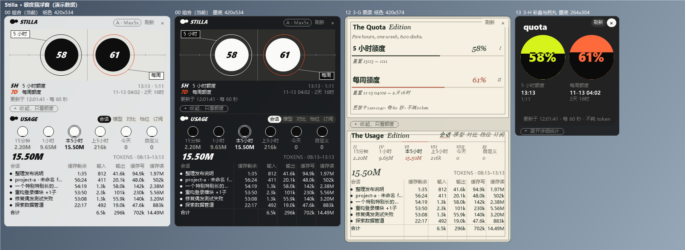
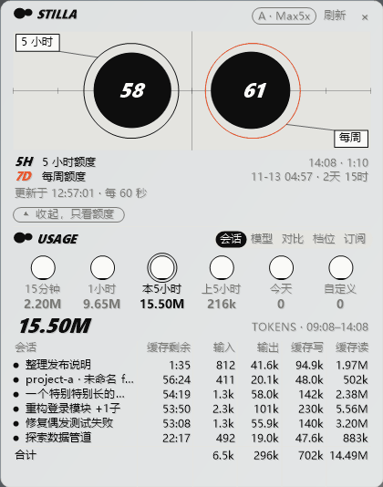
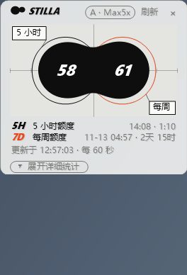

# Stilla

**A small always-on-top quota widget for Claude Code (Windows).** It shows how much of your 5-hour and weekly limits you have used, when they reset, and breaks token usage down by session / model.

> **Stilla is an independent community project. It is not created, endorsed, or officially supported by Anthropic.**
> "Claude" is a trademark of Anthropic, PBC; it is used here only to say what the tool works with.

[中文](README.md)  ·  The UI comes in Chinese and English; this page describes the **English edition** (its source is in [en/](en/); the repository root holds the Chinese edition).



*All screenshots show made-up demo data.*

| Five views: Session · Model · Compare · Tier · Plan | 16 skins, paper and ink |
|:---:|:---:|
|  |  |

*The two animations are slideshows of screenshots rendered from demo data, not screen recordings.*

## What it solves

| The problem | What Stilla does |
|---|---|
| Don't know how much is left | Two ink drops stay on screen; they turn orange at 60% and red at 85%, so you see the cap coming |
| Don't know which session costs the most | Sessions view: one row per session, with the cache time left on it |
| Don't know which model burns the most | Models view converts usage into quota share, with thinking levels listed separately (quota conversion needs Python, optional) |
| More tokens must mean more quota? | Compare view puts token share and quota share side by side; cache reads are cheap, so quota is the better number |
| Is the subscription worth it? | Converts usage to its API-equivalent price and shows your payback multiple |
| Afraid of running out early | Forecasts from the last 12 hours of usage whether the weekly quota will run out before it resets |
| Can't remember the renewal date | Detects your account automatically and sends a system notification before renewal |
| Want to look at one particular period | 11 time ranges, plus a custom one |
| Worried it blocks your code | 16 skins, adjustable transparency, `Ctrl+Alt+B` inverts light/dark |

The quota conversion is an estimate with an error of around 5%: use it to judge trends, not as a bill (the app shows the current estimation error).

## Features

- Floating widget: 5-hour / weekly percent used, reset time, countdown; draggable, resizable, adjustable transparency, tray icon.
- Two modes: it opens in **detailed mode** (quota + usage panel, every core feature in view); one click on the bar under the quota card ("▴ 收起，只看额度") shrinks it to a **simple, quota-only window**, and "▾ 展开详细统计" brings the panel back.
- 16 visual skins, each in light and dark (`Ctrl+Alt+N` next skin, `Ctrl+Alt+B` light/dark).
- Usage panel: per-session / per-model token breakdown over 11 selectable time ranges, prompt-cache time left, quota estimates (optional, needs Python), account / plan accounting.
- Settings window (right-click → 设置…): **update check** (once at each launch by default; a small red dot appears next to the Stilla mark when a new version exists, and one click opens the release page) and a **donate** entry.
- Does not send messages or call any model, so it costs no tokens.

## Install

Windows 10 / 11 only (uses the .NET Framework 4 that ships with Windows).

1. Download `Stilla-Setup-0.1.1-en.exe` (English UI) from [Releases](../../releases) and run it (no admin rights needed; it installs to `%LOCALAPPDATA%\Programs\Stilla`). Prefer no installer? Download `Stilla-0.1.1-portable-en.zip` and unzip it. The Chinese-UI edition is the same program with `-zh` in the file name; both editions install to the same place, so only one can be installed at a time.
2. Tick **"Configure the Claude Code status line"**. This edits `~/.claude/settings.json`: it makes a backup first, keeps any status line you already have (it chains to it), and is undone on uninstall. You can also do it later from the widget's right-click menu.
3. Restart Claude Code and send a message.

> **About the "unknown publisher" warning.** The installer is **not code-signed** (this is a personal project without a paid signing certificate), so Windows SmartScreen may show "Windows protected your PC" (click **More info → Run anyway**), and a few antivirus programs may flag it. To check that your download is what was published:
>
> ```powershell
> certutil -hashfile Stilla-Setup-0.1.1-en.exe SHA256
> ```
>
> The output must match this file's line in `SHA256SUMS-en.txt` on the Release page. The source is public and has no third-party dependencies, so you can also build it yourself with `powershell -ExecutionPolicy Bypass -File build.ps1` (it only needs the `csc.exe` that ships with Windows); run it inside `en/` for the English edition.

## Where the numbers come from

| Mode | How | Notes |
|---|---|---|
| **Status line** (default) | Claude Code's documented [`statusLine`](https://code.claude.com/docs/en/statusline) feature pipes `rate_limits` to `Stilla.Statusline.exe`, which saves it locally | No token access, no network. Updates only while Claude Code runs it; the **VS Code extension and desktop app may not run the status line** (community reports) |
| **Online query** (experimental) | Reads your local Claude login token and calls the undocumented endpoint behind `/usage` | May break at any time; Anthropic's [terms](https://code.claude.com/docs/en/legal-and-compliance) restrict using subscription credentials in tools other than Claude Code. Your call. A warning is shown when you switch to it |
| **Auto** (default) | Status line data if fresh (< 10 min); otherwise online query, **but only after you agree**: the first time there is no status-line data a dialog explains what it does (reads the login token, calls an undocumented endpoint, terms notice). "Yes" enables it, "No" keeps status-line only and it is not asked again | Same caveats as online query once you agree |

## Compatibility

Session usage is read from the session logs Claude Code writes locally (`projects\**\*.jsonl`). Stilla looks in `CLAUDE_CONFIG_DIR` (or `~\.claude`), sibling `.claude*` folders, and desktop-app locations under `%APPDATA%` / `%LOCALAPPDATA%`; other places (WSL, other drives) can be added from the right-click menu (**Claude 数据目录 → 添加目录…**). Desktop-app locations are heuristics and **not verified on a real machine**.

## Privacy

With the default Auto mode Stilla does not read the login token unless you agree in the dialog (and never needs it while the status line delivers data); the only other network use is the update check. See [PRIVACY.md](PRIVACY.md) (Chinese) for exactly which local files are read and written. Usage logs contain session titles and project paths; do not paste the `logs` folder into issues.

## Updates

Stilla checks GitHub for a newer Release once at each launch (on by default; turn it off in the settings window). When there is one, a small red dot appears next to the Stilla mark; "前往更新页面" opens the Release page. It never downloads or installs anything by itself. It needs to reach `api.github.com`; if it can't, the settings window says the check failed and no dot appears.

## Coming next (not in 0.1.1)

These already run on the author's own machine and will be released as soon as time allows (no date promised). Once they are out, everyone who has Stilla installed will see the update dot, so there is no need to search for updates.

| The problem | What the next version does |
|---|---|
| Cache expires and reloading is expensive | One light per session: green = running, blue = waiting for you; the closer the cache is to expiring, the more yellow, then red |
| Too many sessions to find the one waiting on you | Click a session name to jump to the window it lives in |
| Forget to keep the cache warm while busy | A system notification before it expires; optionally an email to yourself (bring your own SMTP) |
| Don't know who is burning quota | Each session shows its speed and share over the last 15 minutes |
| Unsure you will last until the reset | The total row says it outright: at the current pace the 5-hour quota hits the cap in about N hours, and whether the weekly quota runs out early |
| Can't remember where the week went | An automatic weekly HTML report: daily cost, hourly heatmap, model × level, the most expensive sessions, change vs. last week |
| Can't find the costliest session | Click a column header to sort; the cost column shows the API-equivalent amount |
| Which model did a session use? | Models view, click a session: usage per model × level and a timeline of mid-session switches, copyable |
| Using non-Claude models and nobody tracks the cost | The API view lists usage and estimated cost |
| How accurate is the conversion, and how are the numbers computed? | The estimate self-check warns when it drifts, and a hover tooltip explains the numbers |
| Gaming and worried about resources | Three-level scheduling (the lightest keeps only cache reminders), plus one-click pause of background reading |

## Support the project

Stilla is free and open source, with no paid features; donating is entirely optional and unlocks nothing. If it is useful to you, you can support its upkeep through [GitHub Sponsors](https://github.com/sponsors/jly782676356-byte) (one-time or monthly). WeChat / Alipay QR codes are in the [Chinese README](README.md#donate).

## Status

Hobby project, no response-time promise. It depends on Claude Code's local file formats and `statusLine` fields, which can change. What has and has not been verified is listed (in Chinese) at the end of [README.md](README.md).

License: [MIT](LICENSE)
