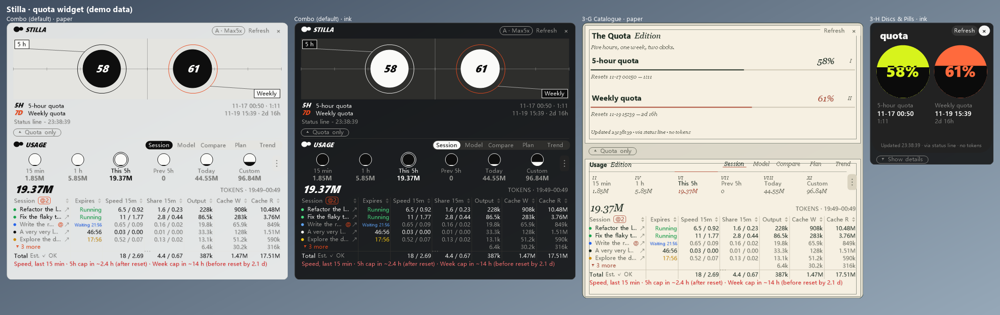
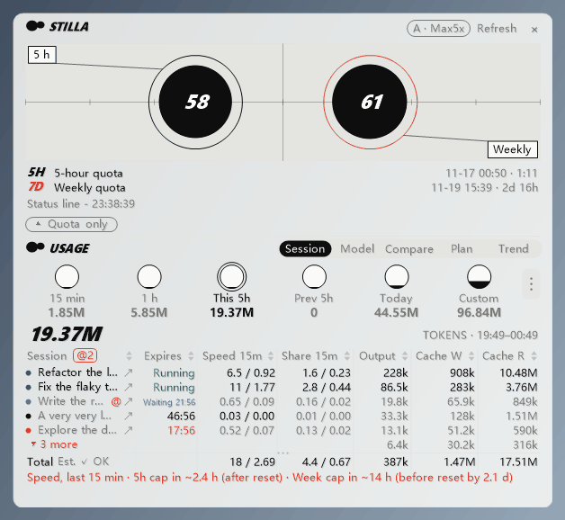
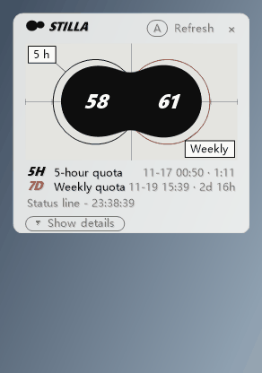

# Stilla

**A quota widget for Claude Code.** A small, always-on-top Windows window that shows how much of your 5-hour and weekly limits you have used and when they reset, and breaks token usage down by session and model.

> **Stilla is an independent community project. It is not made, endorsed or supported by Anthropic.**
> "Claude" is a trademark of Anthropic, PBC; it is used here only to say what the tool works with.

**中文用户请阅读 [README.zh-CN.md](README.zh-CN.md)。** · The UI comes in **English and Chinese** (download the `-en` or the `-zh` installer); both are the same program. The English edition's source is in [en/](en/); the repository root holds the Chinese edition's source.



*All screenshots show made-up demo data.*

| Six views: Session · Model · Compare · Plan · API · Trend | 16 skins, paper and ink |
|:---:|:---:|
|  |  |

*The two animations are slideshows of screenshots rendered from demo data, not screen recordings.*

## What it solves

| The problem | What Stilla does |
|---|---|
| Don't know how much is left | Two ink drops stay on screen; they turn orange at 60% and red at 85%, so you see the cap coming |
| Don't know which session costs the most | Sessions view: one row per session with its cache time left, its quota speed and share over the last 15 minutes (the window is adjustable); click a column header to sort |
| The prompt cache expires and reloading is expensive | One light per session: green = running, blue = waiting for you, and the closer the cache is to expiring, the more yellow, then red. A system notification before it expires; optionally an email to yourself (bring your own SMTP server, off by default) |
| Too many sessions to find the one waiting on you | Click the ↗ next to a session's name to jump to the window it lives in (in VS Code it brings the extension back to that session) |
| Don't know which model burns the most | Models view converts usage into quota share, with thinking levels listed separately; click a session for its usage per model × level and a timeline of mid-session switches (quota conversion needs Python, optional) |
| More tokens must mean more quota? | Compare view lists each model + level with its tokens next to the quota it used ("5h estimate") and a multiple against the cheapest level; cache reads are cheap, so quota is the better number |
| Is the subscription worth it? | Converts usage to its API-equivalent price and shows your payback multiple |
| Afraid of running out early | The row under the total says it outright: at the current pace the 5-hour quota hits the cap in about N hours, and whether the weekly quota runs out before the reset (needs Python). The Plan view also forecasts the weekly quota from the last 12 hours of readings, and the Trend view charts quota used per hour / per day |
| Can't remember where the week went | A weekly HTML report, generated automatically for the previous week: daily cost, hourly heatmap, model × level, the most expensive sessions, change vs. last week |
| How accurate is the conversion, and how are the numbers computed? | An estimate self-check compares the estimate with how far the quota reading actually rose and warns when they drift apart; hover tips explain what each thing is |
| Using non-Claude models and nobody tracks the cost | The API view lists their usage (DeepSeek gets an estimated cost) |
| Gaming and worried about resources | Three profiles (the lightest keeps only the cache reminders, the usage log and memory trimming), plus a switch that pauses background reading |
| Can't remember the renewal date | Detects your account automatically and sends a system notification before renewal |
| Want to look at one particular period | 11 time ranges (one of them custom), with presets and saved favourite ranges |
| Worried it blocks your code | 16 skins, adjustable transparency, `Ctrl+Alt+B` inverts light/dark |

The quota conversion is an estimate: use it to judge trends, not as a bill (the app shows the current estimation error, and the self-check warns when it drifts).

## What it does

*Menu and button names below are the English edition's; the Chinese edition has the same items in Chinese.*

- **Simple and detailed mode**: it opens in **detailed mode** (quota + usage panel, every core feature in view). One click on the bar under the quota card ("▴ Quota only") shrinks it to a **simple, quota-only window**; "▾ Show details" brings the panel back.
- **Quota widget**: percent used of the 5-hour and weekly limits, reset time, countdown. Draggable and resizable, separate background and text transparency, hides to the tray.
- **16 skins**, each in a paper (light) and an ink (dark) version (`Ctrl+Alt+N` next skin, `Ctrl+Alt+B` light / dark). See [all skins (paper)](en/docs/screenshots/skins-light.png) · [(ink)](en/docs/screenshots/skins-dark.png).
- **Usage panel** (part of the detailed mode; right-click → Show usage statistics also toggles it): input / output / cache-write / cache-read tokens per session over selectable time ranges (5 minutes … this week, 11 in all), plus "how long until the prompt cache expires". Six views: Session · Model · Compare · Plan · API · Trend (the API view is hidden by default; see the profiles below).
- **Status lights and cache reminders**: every session gets a light: green = running (being written to), blue = waiting for you (a permission prompt, a question…), and the closer its cache is to expiring the more yellow, then red. When a cache is about to expire you get a system notification (how many minutes ahead is adjustable, 10 by default). You can also get one notification when 5-hour or weekly usage reaches a percentage (90% by default).
- **↗ jump to the session's window**: for a session opened in the VS Code extension, Stilla finds the VS Code window whose title contains the working folder's name, brings it to the front, and opens `vscode://anthropic.claude-code/open?session=<session id>` so the extension returns to that session. For a session opened in a terminal it brings the terminal window to the front (Windows Terminal tabs cannot be selected, only the window).
- **Email reminder (optional, off by default)**: tick the sessions you care about and Stilla sends you an email when their cache has the number of minutes you chose left. You supply your own SMTP server (an app password or authorization code for Gmail, Outlook, QQ Mail, etc.); Stilla connects straight to it, nothing goes through anyone else's server, and the password is stored DPAPI-encrypted on this PC. What the mail contains and what is stored: see [en/PRIVACY.md](en/PRIVACY.md).
- **Speed, share and cap forecast**: each session shows its quota speed (percentage points per hour) and share (percentage points used in total) over the last N minutes (15 by default; 5 minutes to 48 hours); the row under the total gives the cap forecast. These need the quota conversion below, which needs Python.
- **Quota conversion**: uses your own quota readings and usage logs to work out "how many percentage points of quota one dollar of usage costs", and estimates how much each session / model / thinking tier used (needs Python, optional).
- **Sorting, export, details**: click a column header to sort (Session / Model / Compare views); the ⋮ menu at the right end of the time tabs copies the session table or the model × level details to the clipboard or saves them as CSV; in the Model view, click a session to see its usage per model × level and a timeline of mid-session model / level switches, which you can copy as text.
- **Trend view and weekly report**: the Trend view charts quota used per hour (last 24 hours) or per day (last 7 days). The weekly report is one HTML file, generated automatically for the previous week (or on demand from the right-click menu → Weekly report) and stored in the `logs` folder of the data folder.
- **Estimate self-check**: a small hint in the total row that tells you how far the estimated quota use is from the actual rise of the quota reading; click it for details.
- **Profiles and pause**: three profiles (Everything / Recommended / Minimal) decide which background features, views and columns are on and how often background reading happens; "Pause background reading" is for when you are gaming. New installs start on **Recommended**: every feature on, but the low-value "Input" column, the API view and the DeepSeek cost line are hidden; you can switch them on in the features dialog ("Features and display settings...", right-click menu).
- **Hover tips**: rest the mouse on something in the widget and a small note explains what it is, how it is computed and what a click does. On by default; there is a switch in the right-click menu.
- **Accounts and subscriptions**: per-account / per-plan accounting, API-equivalent cost and "payback" multiple.
- **Settings window** (right-click → Settings...): **automatic update check** (once at each launch by default; when a new version exists a small red dot appears to the right of the Stilla mark, and "Go to update page" opens the download page in your browser) and a **donate** entry.
- **Costs no tokens**: it sends no messages and calls no model. How much it reads in the background depends on the profile; Minimal reads the least.

The full guide (where every item is in the menus, the defaults, and the `settings.txt` keys you can edit by hand) is in [en/docs/USAGE.md](en/docs/USAGE.md).

## Install

**Windows 10 / 11 only** (it uses the .NET Framework 4 that ships with Windows; nothing else to install).

1. Download an installer from [Releases](../../releases) and run it (no administrator rights needed; it installs to `%LOCALAPPDATA%\Programs\Stilla`): `Stilla-Setup-0.2.0-en.exe` for the **English UI** or `Stilla-Setup-0.2.0-zh.exe` for the **Chinese UI**. If you would rather not install, download `Stilla-0.2.0-portable-en.zip` (or `-zh.zip`) and unzip it. Both editions install to the same place, so only one can be installed at a time.
2. In the installer, **tick "Configure the Claude Code status line"** (see below). This edits `~/.claude/settings.json`: it makes a backup first, keeps any status line you already have, and is undone on uninstall. You can also leave it unticked and set it up later from Stilla's right-click menu.
3. Restart Claude Code and send a message; the widget now has data.

> **About the "unknown publisher" warning.** The installer is **not code-signed** (this is a personal project without a paid signing certificate), so Windows SmartScreen may show "Windows protected your PC" (click **More info → Run anyway**), and a few antivirus programs may flag it. To check that your download is what was published:
>
> ```powershell
> certutil -hashfile Stilla-Setup-0.2.0-en.exe SHA256
> ```
>
> The output must match this file's line in `SHA256SUMS-en.txt` (`SHA256SUMS-zh.txt` for the Chinese edition) on the Release page. The source is public and has no third-party dependencies, so you can also [build it yourself](#build-from-source) with the `csc.exe` that ships with Windows.

Silent install / uninstall (same switches for both editions): `Stilla-Setup-0.2.0-en.exe /S [/D=<install folder>] [/nostatusline] [/desktop] [/autostart] [/nolaunch]`; `Stilla-Setup.exe /uninstall /S [/purge]`.

### Upgrading from 0.1.x

Just run the new installer: it closes a running Stilla and replaces only the program files, leaving the settings and history in `%APPDATA%\Stilla` alone. What changes:

- The views were renumbered: the old Tier view was merged into Compare, and there are two new views, API and Trend.
- The window size saved by 0.1.x is dropped once (the new panel is wider, and an old size would squeeze the new columns out), and column widths go back to the defaults.
- New installs and upgrades start from the same place, the Recommended profile, which hides the "Input" column, the API view and the DeepSeek cost line. The old right-click item "Show DeepSeek estimate line" moved into the features dialog (if you had switched it on in 0.1.x, it stays on after the upgrade).
- The new cache reminder also reads the end of the session logs every ten-odd seconds while the usage panel is closed (0.1.x had no such feature). To stop Stilla reading session files altogether, see "I do not want to be tracked" in the FAQ.

Unchanged: status-line data, the update check, the donate entry, and the rule that your data stays on this machine. Item-by-item notes are at the end of [en/docs/USAGE.md](en/docs/USAGE.md) ("Upgrading to 0.2.0").

## Where the numbers come from

Claude Code has no public "get my quota" API, so there are three ways, selectable in the right-click menu under **Quota data source**. **The default is "Auto"**: the status line is used whenever it has fresh data; when it has none, you are asked once whether the online query may be used instead (see below).

| Mode | How | Upside | Downside |
|---|---|---|---|
| **Status line** | Claude Code's official [`statusLine`](https://code.claude.com/docs/en/statusline) feature hands `rate_limits` (the 5-hour / weekly percentages and reset times) to `Stilla.Statusline.exe` on stdin; it saves them to a local file and the widget reads that file | The documented way; **reads no login token and uses no network** | Only updates while Claude Code is running; **the VS Code extension and the desktop app may not run the status line** (see below) |
| **Online query** (experimental) | Reads the Claude login token on this machine and calls the **undocumented** endpoint that Claude Code's `/usage` uses | Does not depend on which Claude client you use | The endpoint can change at any time; Anthropic's [terms](https://code.claude.com/docs/en/legal-and-compliance) restrict using subscription login credentials in tools other than Claude Code, so **whether this is appropriate is your decision**. A warning is shown when you switch to it |
| **Auto** (default) | Uses status-line data if it is fresh (within 10 minutes); otherwise the online query, **but only after you agree**: the first time the status line has no data a dialog explains what it does (reads the login token, calls an undocumented endpoint, terms notice). "Yes" enables it; "No" keeps Stilla on the status line only and it is not asked again | Command-line users only need the status line; VS Code / desktop-app users get data right away once they agree | Same caveats as the online query once you agree |

**Chaining an existing status line**: if your `settings.json` already has a `statusLine`, the installer / settings dialog does not overwrite it. The original command is saved and `Stilla.Statusline.exe --chain-file …` runs it for you, so your own status line keeps working.

Manual setup (if you do not want a program editing your files): add this to `~/.claude/settings.json`, with the path adjusted:

```json
{
  "statusLine": {
    "type": "command",
    "command": "\"C:\\Users\\you\\AppData\\Local\\Programs\\Stilla\\Stilla.Statusline.exe\" --quiet"
  }
}
```

## Compatibility: different Claude clients and install locations

Session usage is read from the session logs Claude Code writes on this machine (`projects\**\*.jsonl`). Stilla **finds these folders automatically** and does not assume a fixed location:

| Source | How it is found | Status |
|---|---|---|
| Command line (`claude`) | the `CLAUDE_CONFIG_DIR` environment variable, otherwise `~\.claude` | implemented from the Claude Code documentation |
| VS Code extension | same as above | used daily by the author (the logs come from the VS Code extension) |
| Several config folders (side-by-side folders such as `~\.claude-work`) | automatic scan for `.claude*` in your user folder | tested with fake folders |
| Desktop app / Microsoft Store version | automatic scan for folders named `.claude` under `%APPDATA%\Claude`, `%LOCALAPPDATA%\Claude` and `Packages\*Claude*` | **not verified on a real machine** (the author's machine has no desktop app) |
| WSL, other drives, other places | right-click → **Claude data folders → Add folder…** | works, manual |
| JetBrains plugin | same as the command line | not verified |

Right-click → **Claude data folders** shows which folders are actually being read.

The **quota percentages** depend on the data source (previous section): the status-line mode is most reliable with the **command-line version**; the community reports that the **VS Code extension does not render / may not trigger `statusLine`**, and there is no clear information for the desktop app. If you mainly use VS Code or the desktop app, the status line may never produce data. Then answer "Yes" in the Auto dialog or choose "Online query" (mind the terms notice above), or just use the session usage statistics, which do not depend on the quota source.

The **status lights and the ↗ jump** use the session state that Claude Code writes into `sessions\*.json` (Claude Code does not document that file's format, so it may change) and the titles of VS Code windows. The jump only recognises VS Code and VS Code Insiders windows (Cursor, VSCodium and Windsurf windows are never matched); terminal sessions can only be brought to the front as a window.

## Updates

- **One check at every launch** (can be turned off in right-click → Settings...): one request to GitHub asking "which version is the latest Release". It sends only `User-Agent: Stilla/<version>` and none of your data.
- When a new version exists, a **small red dot** appears to the right of the Stilla mark (and the tray shows a notice once). Click the dot, or right-click → Settings... → **Go to update page**, to open the download page in your browser. **Nothing is downloaded or installed automatically.**
- To stay offline: untick it in Settings, or set the environment variable `STILLA_NO_UPDATE_CHECK=1`.
- The check needs to reach GitHub (`api.github.com`). If it can't, the settings window says the check failed and no dot appears; you can always look at [Releases](../../releases) yourself.

<a name="donate"></a>

## Support this project

Stilla is free and open source, with no paid features; donating is entirely optional and unlocks nothing. If it is useful to you, you can support its upkeep:

- **GitHub Sponsors** (one-time or monthly): <https://github.com/sponsors/jly782676356-byte>
- **WeChat Pay / Alipay** (scan the QR code; handy for supporters in China):

| WeChat Pay | Alipay |
|---|---|
|  |  |

Settings... → Donate... in the program opens this section.

## Privacy

With the default "Auto" source Stilla **does not read the login token unless you agree** in the dialog (and never needs it while the status line delivers data), and it uploads nothing. It goes online in exactly one place by default: the update check at launch (described above, can be turned off). Two features you switch on yourself add one more each: agreeing to the online query (or choosing "Online query" by hand) calls Claude's usage endpoint, and turning on the email reminder sends mail to **the SMTP server you configured** (off by default; the mail contains the session's title). Which local files are read, which are written, and when the network is used are all listed in [en/PRIVACY.md](en/PRIVACY.md). In one sentence: the usage logs, the weekly reports and the exports contain session titles and project paths, so **do not paste the `logs` folder, a weekly report or an exported file when you report a problem**.

## FAQ

- **I only want the quota, not the usage panel**: click "▴ Quota only" under the quota card (or untick "Show usage statistics" in the right-click menu).
- **I want it as light as possible / I am gaming**: right-click → pick the Minimal profile (it keeps the cache reminders, the usage log and memory trimming; no history reading, no Python, no weekly report), or turn on "Pause background reading" in the right-click or tray menu: while paused, session logs are not read at all (neither for the panel nor for the usage log, which catches up after you resume) and there are no cache reminders; the quota reading continues.
- **The bottom of the widget says no status-line data has been received**: the status line is not set up yet, or Claude Code has not run it yet. Right-click → Quota data source → Set up the Claude Code status line; then restart Claude Code and send a message. For VS Code / the desktop app see the compatibility notes above.
- **It says the data has not been updated for N minutes**: status-line data only updates while Claude Code is running.
- **No quota estimates, speed, share, cap forecast or API-equivalent cost (all "—"), or wrong session titles**: the quota estimates, speed, share, cap forecast and API-equivalent cost all come from the quota conversion table that the Python script `scripts\quota_fit.py` produces; session titles prefer the titles shown in VS Code, which another Python script reads. Without Python these are unavailable and everything else works as usual. They also show "—" while there is not enough data (a new account, a plan change); they fill in once enough has accumulated.
- **I can't find the "Input" column, the API view or the DeepSeek cost line**: the Recommended profile hides them. Switch them on in the features dialog (right-click → "Features and display settings...") or pick the Everything profile.
- **The ↗ jump opened the wrong window / did not select the Windows Terminal tab**: Stilla finds the VS Code window by the folder name in its title, so two windows with a same-named folder can be confused; for Windows Terminal it can only bring the window forward, not select a tab.
- **The email reminder cannot send**: press "Send test email" in the email reminder dialog first and read the error. Gmail / Outlook / QQ Mail need an app password or authorization code, not your login password; use port 587 (STARTTLS), because port 465 (implicit SSL) is not supported.
- **I want another location / portable use**: put an empty file `portable.txt` next to `Stilla.exe`; settings and logs then go to a `data` folder next to it.
- **I do not want to be tracked**: right-click → untick "Log usage to file"; also untick the cache-expiry notification item and turn "Show usage statistics" off, and Stilla reads no session files at all (while any one of the three is still on, it reads the newly added part of the session logs).

## Build from source

No Visual Studio and no .NET SDK needed; the .NET Framework 4 compiler that ships with Windows is enough:

```powershell
powershell -ExecutionPolicy Bypass -File build.ps1
```

Run it in the repository root for the **Chinese-UI edition**, or inside [en/](en/) for the **English-UI edition**. The output goes to `dist\`: `Stilla.exe`, `Stilla.Statusline.exe`, `scripts\`, and the installer and portable zip (`Stilla-Setup-0.2.0-zh.exe` / `Stilla-0.2.0-portable-zh.zip`, or `-en` for the English edition). To publish a Release, then run `tools\make-release.ps1 -OutDir <folder>`, which collects the installer, the zip, `SHA256SUMS` and draft release notes. The source is C# 5 (the version of the system `csc.exe`), so do not use `?.` or string interpolation. See [en/CONTRIBUTING.md](en/CONTRIBUTING.md) for contribution notes and [en/CHANGELOG.md](en/CHANGELOG.md) for the version history.

`en/` is generated from the Chinese-edition source in the repository root with a translation table (the translation pipeline is not in the repository yet), so edits made directly in `en/` are overwritten the next time it is regenerated. To change English wording or fix a problem in the English edition, please open an issue or a PR and I will fold it into the translation table.

**If you fork the project**: run `tools\set-repo.ps1 -Owner <your user name>` to point the update check and the donate entry at your own repository, then build again (if you do not, your build checks this project for new versions).

UI rendering test (16 skins × paper / ink × several window sizes / DPI scales, drawn to PNG from fake data, no window pops up):

```powershell
powershell -ExecutionPolicy Bypass -File tools\ui-check\run.ps1 -Scenario all
```

## Verification status (the honest version)

**Verified on the development machine at 0.1.1**: everything compiles (warnings as errors); `Stilla.Statusline.exe` reading stdin / writing the file / chaining the original status line / tolerating bad input (with synthetic input); writing and undoing the `statusLine` entry in `settings.json` (backup, other fields kept, bad JSON left alone, existing status line chained and restored); install / uninstall (including paths with spaces, a clean removal); detection of several data folders (with fake folders); rendering of the 16 skins in paper / ink, at several window sizes and at 1.25× / 1.5× / 2× scaling.

**The 0.2.0 features** come from the author's own build, which already runs on the author's own machine (with the VS Code extension).

**Run before the 0.2.0 release** (fake data and temporary folders only; nothing touched a real profile): both editions compile with warnings as errors; 525 automated logic checks pass and none fail; they cover settings upgrade from 0.1.1, profiles, mail settings and the DPAPI round trip, a weekly report built from hostile session titles, forecast / speed maths, exports, sorting; the suite itself was tested by planting 22 bugs, all of which it caught); the layout harness drew 938 frames per edition (16 skins × paper / ink × window sizes × 1.25 / 1.5 / 2.0 scaling × views × edge cases) and checked them for clipped, overlapping and edge-touching text; both installers were installed into a folder with a space, upgraded over an installed 0.1.1, switched between the two editions and uninstalled; the update check (against a local fake server), the first-run question about the online query (both answers) and the status-line helper were run on the real processes; the new code had its own security review (no high-severity finding; the medium ones are fixed).

**Not verified**: whether a real Claude Code actually calls the status-line program as expected (not tested with the command line, VS Code or the desktop app); the real location of the desktop app's session folder; WSL; DPI changes between monitors; whether the "Online query" mode still works today (it keeps the original implementation and was not re-tested online during this clean-up). Also not verified in 0.2.0: real SMTP servers (only a loopback fake server was used, for headers and limits); actually launching `vscode://` and switching windows; the clipboard export and the Save-as dialog; real 125 % / 150 % screens (dialogs were only simulated at those scales) and Windows 10. New in 0.2.0:

- **The ↗ jump**: designed only for sessions in the VS Code extension (the window's process name must start with `Code`, i.e. VS Code and Insiders; Cursor, VSCodium and Windsurf are never matched) and for the terminal window that is the session's parent process; JetBrains is not verified; it matches windows by the folder name in the title, so same-named folders can be confused; the `vscode://anthropic.claude-code/open` address is handled by the Claude Code extension and may stop working if the extension changes it.
- **The blue "waiting for you" light**: depends on the `status` field Claude Code writes into `sessions\*.json`, a file whose format is not documented; whether every Claude Code version and client writes it has not been verified.
- **The email reminder**: only promises "if your SMTP server works, it sends"; the rules of each provider (Gmail, Outlook, QQ Mail, …: app passwords, ports, encryption) have not been checked one by one.
- **Speed, share, cap forecast, estimate self-check, API-equivalent cost**: all built on the quota conversion table; they are estimates, not a bill, and no accuracy is promised.
- **The weekly report**: the same estimates; amounts are API-equivalent prices at the official list price, not what your subscription charges.

**Known issues in 0.2.0** (found by the automated suite; not fixed in this release):

- A session title that contains a line break is not sent by the cache email: the title goes into the mail subject unchanged, so sending fails and a failure notice appears instead.
- The weekly report can still be generated when the usage history exists but has no entries for the previous week: the page is empty and a notification appears.
- The email form does not check address syntax (for example `not-an-address`); the error only appears when sending.

## Project status

A hobby project with no response-time promise. It depends on the format of Claude Code's local files and on the `statusLine` fields, which change with Claude Code versions and may break at any time. If that happens please open an issue and include your Claude Code version and the client you use.

## License

[MIT](LICENSE)
