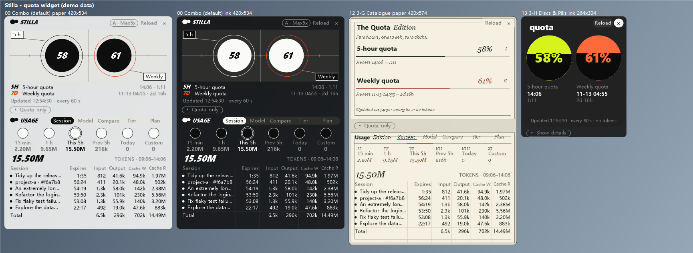
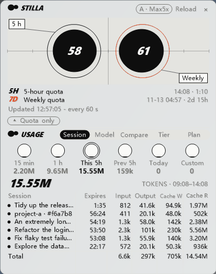
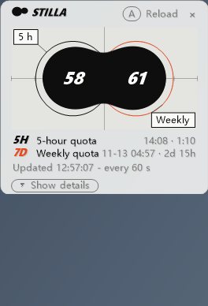

# Stilla

**A quota widget for Claude Code.** A small, always-on-top Windows window that shows how much of your 5-hour and weekly limits you have used and when they reset, and breaks token usage down by session and model.

> **Stilla is an independent community project. It is not made, endorsed or supported by Anthropic.**
> "Claude" is a trademark of Anthropic, PBC; it is used here only to say what the tool works with.

**中文用户请阅读 [README.zh-CN.md](README.zh-CN.md)。** · The UI comes in **English and Chinese** (download the `-en` or the `-zh` installer); both are the same program. The English edition's source is in [en/](en/); the repository root holds the Chinese edition's source.



*All screenshots show made-up demo data.*

| Five views: Session · Model · Compare · Tier · Plan | 16 skins, paper and ink |
|:---:|:---:|
|  |  |

*The two animations are slideshows of screenshots rendered from demo data, not screen recordings.*

## What it solves

| The problem | What Stilla does |
|---|---|
| Don't know how much is left | Two ink drops stay on screen; they turn orange at 60% and red at 85%, so you see the cap coming |
| Don't know which session costs the most | Sessions view: one row per session, with the cache time left on it |
| Don't know which model burns the most | Models view converts usage into quota share, with thinking levels listed separately (quota conversion needs Python, optional) |
| More tokens must mean more quota? | Compare view puts token share and quota share side by side; cache reads are cheap, so quota is the better number |
| Is the subscription worth it? | Converts usage to its API-equivalent price and shows your payback multiple |
| Afraid of running out early | Forecasts from the last 12 hours of usage whether the weekly quota will run out before it resets |
| Can't remember the renewal date | Detects your account automatically and sends a system notification before renewal |
| Want to look at one particular period | 11 time ranges, plus a custom one |
| Worried it blocks your code | 16 skins, adjustable transparency, `Ctrl+Alt+B` inverts light/dark |

The quota conversion is an estimate with an error of around 5%: use it to judge trends, not as a bill (the app shows the current estimation error).

## What it does

*Menu and button names below are the English edition's; the Chinese edition has the same items in Chinese.*

- **Simple and detailed mode**: it opens in **detailed mode** (quota + usage panel, every core feature in view). One click on the bar under the quota card ("▴ Quota only") shrinks it to a **simple, quota-only window**; "▾ Show details" brings the panel back.
- **Quota widget**: percent used of the 5-hour and weekly limits, reset time, countdown. Draggable and resizable, separate background and text transparency, hides to the tray.
- **16 skins**, each in a paper (light) and an ink (dark) version (`Ctrl+Alt+N` next skin, `Ctrl+Alt+B` light / dark). See [all skins (paper)](en/docs/screenshots/skins-light.png) · [(ink)](en/docs/screenshots/skins-dark.png).
- **Usage panel** (part of the detailed mode; right-click → Show usage statistics also toggles it): input / output / cache-write / cache-read tokens per session over selectable time ranges (5 minutes … this week, 11 in all), plus "how long until the prompt cache expires". Five views: Session · Model · Compare · Tier · Plan.
- **Quota conversion**: uses your own quota readings and usage logs to work out "how many percentage points of quota one dollar of usage costs", and estimates how much each session / model / thinking tier used (needs Python, optional).
- **Accounts and subscriptions**: per-account / per-plan accounting, API-equivalent cost and "payback" multiple.
- **Settings window** (right-click → Settings...): **automatic update check** (once at each launch by default; when a new version exists a small red dot appears to the right of the Stilla mark, and "Go to update page" opens the download page in your browser) and a **donate** entry.
- **Costs no tokens**: it sends no messages and calls no model. About 0.1% CPU when idle.

The full guide is in [en/docs/USAGE.md](en/docs/USAGE.md).

## Install

**Windows 10 / 11 only** (it uses the .NET Framework 4 that ships with Windows; nothing else to install).

1. Download an installer from [Releases](../../releases) and run it (no administrator rights needed; it installs to `%LOCALAPPDATA%\Programs\Stilla`): `Stilla-Setup-0.1.1-en.exe` for the **English UI** or `Stilla-Setup-0.1.1-zh.exe` for the **Chinese UI**. If you would rather not install, download `Stilla-0.1.1-portable-en.zip` (or `-zh.zip`) and unzip it. Both editions install to the same place, so only one can be installed at a time.
2. In the installer, **tick "Configure the Claude Code status line"** (see below). This edits `~/.claude/settings.json`: it makes a backup first, keeps any status line you already have, and is undone on uninstall. You can also leave it unticked and set it up later from Stilla's right-click menu.
3. Restart Claude Code and send a message; the widget now has data.

> **About the "unknown publisher" warning.** The installer is **not code-signed** (this is a personal project without a paid signing certificate), so Windows SmartScreen may show "Windows protected your PC" (click **More info → Run anyway**), and a few antivirus programs may flag it. To check that your download is what was published:
>
> ```powershell
> certutil -hashfile Stilla-Setup-0.1.1-en.exe SHA256
> ```
>
> The output must match this file's line in `SHA256SUMS-en.txt` (`SHA256SUMS-zh.txt` for the Chinese edition) on the Release page. The source is public and has no third-party dependencies, so you can also [build it yourself](#build-from-source) with the `csc.exe` that ships with Windows.

Silent install / uninstall (same switches for both editions): `Stilla-Setup-0.1.1-en.exe /S [/D=<install folder>] [/nostatusline] [/desktop] [/autostart] [/nolaunch]`; `Stilla-Setup.exe /uninstall /S [/purge]`.

## Where the numbers come from

Claude Code has no public "get my quota" API, so there are three ways, selectable in the right-click menu under **Quota data source**. **The default is "Auto"**: the status line is used whenever it has fresh data; when it has none, you are asked once whether the online query may be used instead (see below).

| Mode | How | Upside | Downside |
|---|---|---|---|
| **Status line** | Claude Code's official [`statusLine`](https://code.claude.com/docs/en/statusline) feature hands `rate_limits` (the 5-hour / weekly percentages and reset times) to `Stilla.Statusline.exe` on stdin; it saves them to a local file and the widget reads that file | The documented way; **reads no login token and uses no network** | Only updates while Claude Code is running; **the VS Code extension and the desktop app may not run the status line** (see below) |
| **Online query** (experimental) | Reads the Claude login token on this machine and calls the **undocumented** endpoint that Claude Code's `/usage` uses | Does not depend on which Claude client you use | The endpoint can change at any time; Anthropic's [terms](https://code.claude.com/docs/en/legal-and-compliance) restrict using subscription login credentials in tools other than Claude Code, so **whether this is appropriate is your decision**. A warning is shown when you switch to it |
| **Auto** (default) | Uses status-line data if it is fresh (within 10 minutes); otherwise the online query, **but only after you agree**: the first time the status line has no data a dialog explains what it does (reads the login token, calls an undocumented endpoint, terms notice). "Yes" enables it; "No" keeps Stilla on the status line only and it is not asked again | Command-line users only need the status line; VS Code / desktop-app users get data right away once they agree | Same caveats as the online query once you agree |

**Chaining an existing status line**: if your `settings.json` already has a `statusLine`, the installer / settings dialog does not overwrite it. The original command is saved and `Stilla.Statusline.exe --chain-file …` runs it for you, so your own status line keeps working.

Manual setup (if you do not want a program editing your files): add this to `~/.claude/settings.json`, with the path adjusted:

```json
{
  "statusLine": {
    "type": "command",
    "command": "\"C:\\Users\\you\\AppData\\Local\\Programs\\Stilla\\Stilla.Statusline.exe\" --quiet"
  }
}
```

## Compatibility: different Claude clients and install locations

Session usage is read from the session logs Claude Code writes on this machine (`projects\**\*.jsonl`). Stilla **finds these folders automatically** and does not assume a fixed location:

| Source | How it is found | Status |
|---|---|---|
| Command line (`claude`) | the `CLAUDE_CONFIG_DIR` environment variable, otherwise `~\.claude` | implemented from the Claude Code documentation |
| VS Code extension | same as above | used daily by the author (the logs come from the VS Code extension) |
| Several config folders (side-by-side folders such as `~\.claude-work`) | automatic scan for `.claude*` in your user folder | tested with fake folders |
| Desktop app / Microsoft Store version | automatic scan for folders named `.claude` under `%APPDATA%\Claude`, `%LOCALAPPDATA%\Claude` and `Packages\*Claude*` | **not verified on a real machine** (the author's machine has no desktop app) |
| WSL, other drives, other places | right-click → **Claude data folders → Add folder…** | works, manual |
| JetBrains plugin | same as the command line | not verified |

Right-click → **Claude data folders** shows which folders are actually being read.

The **quota percentages** depend on the data source (previous section): the status-line mode is most reliable with the **command-line version**; the community reports that the **VS Code extension does not render / may not trigger `statusLine`**, and there is no clear information for the desktop app. If you mainly use VS Code or the desktop app, the status line may never produce data. Then answer "Yes" in the Auto dialog or choose "Online query" (mind the terms notice above), or just use the session usage statistics, which do not depend on the quota source.

## Updates

- **One check at every launch** (can be turned off in right-click → Settings...): one request to GitHub asking "which version is the latest Release". It sends only `User-Agent: Stilla/<version>` and none of your data.
- When a new version exists, a **small red dot** appears to the right of the Stilla mark (and the tray shows a notice once). Click the dot, or right-click → Settings... → **Go to update page**, to open the download page in your browser. **Nothing is downloaded or installed automatically.**
- To stay offline: untick it in Settings, or set the environment variable `STILLA_NO_UPDATE_CHECK=1`.
- The check needs to reach GitHub (`api.github.com`). If it can't, the settings window says the check failed and no dot appears; you can always look at [Releases](../../releases) yourself.

## Coming next (not in 0.1.1)

These already run on the author's own machine and will be released as soon as time allows (no date promised). Once they are out, everyone who has Stilla installed will see the update dot, so there is no need to search for updates.

| The problem | What the next version does |
|---|---|
| Cache expires and reloading is expensive | One light per session: green = running, blue = waiting for you; the closer the cache is to expiring, the more yellow, then red |
| Too many sessions to find the one waiting on you | Click a session name to jump to the window it lives in |
| Forget to keep the cache warm while busy | A system notification before it expires; optionally an email to yourself (bring your own SMTP) |
| Don't know who is burning quota | Each session shows its speed and share over the last 15 minutes |
| Unsure you will last until the reset | The total row says it outright: at the current pace the 5-hour quota hits the cap in about N hours, and whether the weekly quota runs out early |
| Can't remember where the week went | An automatic weekly HTML report: daily cost, hourly heatmap, model × level, the most expensive sessions, change vs. last week |
| Can't find the costliest session | Click a column header to sort; the cost column shows the API-equivalent amount |
| Which model did a session use? | Models view, click a session: usage per model × level and a timeline of mid-session switches, copyable |
| Using non-Claude models and nobody tracks the cost | The API view lists usage and estimated cost |
| How accurate is the conversion, and how are the numbers computed? | The estimate self-check warns when it drifts, and a hover tooltip explains the numbers |
| Gaming and worried about resources | Three-level scheduling (the lightest keeps only cache reminders), plus one-click pause of background reading |

<a name="donate"></a>

## Support this project

Stilla is free and open source, with no paid features; donating is entirely optional and unlocks nothing. If it is useful to you, you can support its upkeep:

- **GitHub Sponsors** (one-time or monthly): <https://github.com/sponsors/jly782676356-byte>
- **WeChat Pay / Alipay** (scan the QR code; handy for supporters in China):

| WeChat Pay | Alipay |
|---|---|
|  |  |

Settings... → Donate... in the program opens this section.

## Privacy

With the default "Auto" source Stilla **does not read the login token unless you agree** in the dialog (and never needs it while the status line delivers data), and it uploads nothing. It goes online in exactly one place: the update check at launch (described above, can be turned off); agreeing to the online query (or choosing "Online query" by hand) adds a second one. Which local files are read, which are written, and when the network is used are all listed in [en/PRIVACY.md](en/PRIVACY.md). In one sentence: the usage logs contain session titles and project paths, so **do not paste the `logs` folder when you report a problem**.

## FAQ

- **I only want the quota, not the usage panel**: click "▴ Quota only" under the quota card (or untick "Show usage statistics" in the right-click menu).
- **The bottom of the widget says no status-line data has been received**: the status line is not set up yet, or Claude Code has not run it yet. Right-click → Quota data source → Set up the Claude Code status line; then restart Claude Code and send a message. For VS Code / the desktop app see the compatibility notes above.
- **It says the data has not been updated for N minutes**: status-line data only updates while Claude Code is running.
- **No quota estimates / wrong session titles**: both depend on the Python scripts in `scripts\`; without Python they are unavailable and everything else works as usual. Session titles prefer the titles shown in VS Code.
- **I want another location / portable use**: put an empty file `portable.txt` next to `Stilla.exe`; settings and logs then go to a `data` folder next to it.
- **I do not want to be tracked**: right-click → untick "Log usage to file"; while "Show usage statistics" is off, the session files are not read at all.

## Build from source

No Visual Studio and no .NET SDK needed; the .NET Framework 4 compiler that ships with Windows is enough:

```powershell
powershell -ExecutionPolicy Bypass -File build.ps1
```

Run it in the repository root for the **Chinese-UI edition**, or inside [en/](en/) for the **English-UI edition**. The output goes to `dist\`: `Stilla.exe`, `Stilla.Statusline.exe`, `scripts\`, and the installer and portable zip (`Stilla-Setup-0.1.1-zh.exe` / `Stilla-0.1.1-portable-zh.zip`, or `-en` for the English edition). To publish a Release, then run `tools\make-release.ps1 -OutDir <folder>`, which collects the installer, the zip, `SHA256SUMS` and draft release notes. The source is C# 5 (the version of the system `csc.exe`), so do not use `?.` or string interpolation. See [en/CONTRIBUTING.md](en/CONTRIBUTING.md) for contribution notes and [en/CHANGELOG.md](en/CHANGELOG.md) for the version history.

`en/` is generated from the Chinese-edition source in the repository root with a translation table (the translation pipeline is not in the repository yet), so edits made directly in `en/` are overwritten the next time it is regenerated. To change English wording or fix a problem in the English edition, please open an issue or a PR and I will fold it into the translation table.

**If you fork the project**: run `tools\set-repo.ps1 -Owner <your user name>` to point the update check and the donate entry at your own repository, then build again (if you do not, your build checks this project for new versions).

UI rendering test (16 skins × paper / ink × several window sizes / DPI scales, drawn to PNG from fake data, no window pops up):

```powershell
powershell -ExecutionPolicy Bypass -File tools\ui-check\run.ps1 -Scenario all
```

## Verification status (the honest version)

**Verified on the development machine**: everything compiles (warnings as errors); `Stilla.Statusline.exe` reading stdin / writing the file / chaining the original status line / tolerating bad input (with synthetic input); writing and undoing the `statusLine` entry in `settings.json` (backup, other fields kept, bad JSON left alone, existing status line chained and restored); install / uninstall (including paths with spaces, a clean removal); detection of several data folders (with fake folders); rendering of the 16 skins in paper / ink, at several window sizes and at 1.25× / 1.5× / 2× scaling.

**Not verified**: whether a real Claude Code actually calls the status-line program as expected (not tested with the command line, VS Code or the desktop app); the real location of the desktop app's session folder; WSL; DPI changes between monitors; whether the "Online query" mode still works today (it keeps the original implementation and was not re-tested online during this clean-up).

## Project status

A hobby project with no response-time promise. It depends on the format of Claude Code's local files and on the `statusLine` fields, which change with Claude Code versions and may break at any time. If that happens please open an issue and include your Claude Code version and the client you use.

## License

[MIT](LICENSE)
