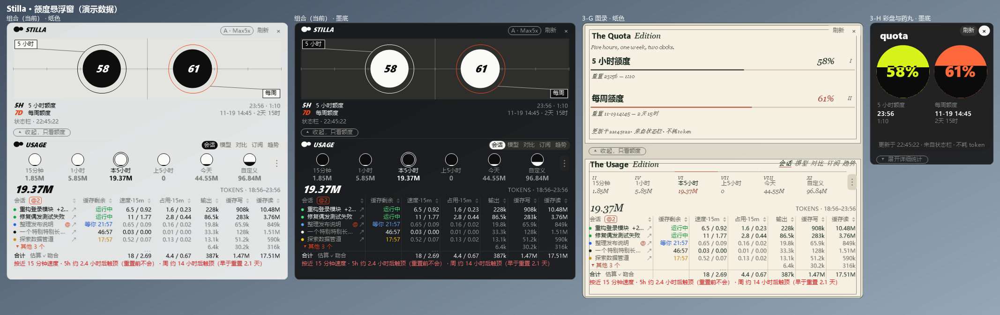
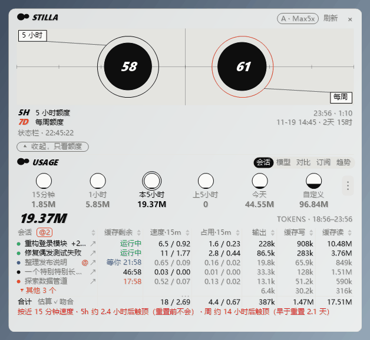
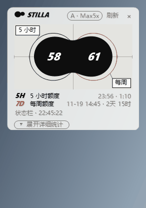

# Stilla

**给 Claude Code 用的额度悬浮窗。** 一个很小的、始终置顶的 Windows 窗口，随时显示 5 小时额度和每周额度用了多少、什么时候重置，还能按会话 / 模型统计 token 用量。

> **Stilla 是独立的社区项目，不是 Anthropic 出品，也没有得到 Anthropic 的认可或支持。**
> "Claude" 是 Anthropic, PBC 的商标，这里只用来说明本工具是给 Claude Code 用的。

**[English](README.md)** · 界面有中文和英文两个版本（下载 `-zh` 或 `-en` 安装包，是同一个程序）；英文界面版的源码在 [en/](en/)。



*截图均为虚构的演示数据。 / All screenshots show made-up demo data.*

| 六个视图：会话 · 模型 · 对比 · 订阅 · API · 趋势 | 16 种风格 × 纸色 / 墨底 |
|:---:|:---:|
|  |  |

*上面两张动图是演示数据渲染图的轮播，不是屏幕录像。*

## 它解决这几件事

| 你遇到的问题 | Stilla 怎么做 |
|---|---|
| 不知道还剩多少 | 两滴墨常驻，60% 变橙、85% 变红，到顶前先知道 |
| 不知道谁最费 | 会话视图一行一个会话：缓存剩余、近 15 分钟（窗口可改）的消耗速度和占用的额度都在上面，点表头可以排序 |
| 缓存过期，重新载入贵 | 每个会话一盏灯：绿 = 运行中，蓝 = 等你处理，缓存越接近过期越黄、越红；快过期时弹系统通知，也可以发邮件到你自己的邮箱（自备 SMTP，默认关） |
| 会话一多，找不到等回复的 | 点会话名右边的 ↗，跳到它所在的窗口（VS Code 里会回到那个会话） |
| 不知道哪个模型花得多 | 模型视图折成额度，思考档位也单独列出；点一个会话，看它每个「模型 × 档位」的用量和中途切换的时间线（额度折算需要 Python，可选） |
| token 多就以为费额度 | 对比视图每个「模型 + 档位」一行，把 token 和折算的额度（5h 估算）并排，再给出比最省那一档多耗几倍；缓存读便宜，看额度更准 |
| 订阅不知值不值 | 折成 API 金额，算出回本倍数 |
| 怕额度提前用完 | 合计行下面直接写：照现在的速度，5 小时额度约几小时后触顶，每周额度会不会在重置前用完（需要 Python）；订阅视图里还有按近 12 小时额度读数推算的每周额度预测；趋势视图画每小时 / 每天用掉了多少额度 |
| 一周花在哪记不清 | 每周自动生成一份 HTML 周报：每天花费、小时热力图、模型 × 档位、最烧额度的会话、较上周的变化 |
| 折算准不准、数字怎么算的 | 估算自检拿额度读数的涨幅核对估算，偏差大会提示；鼠标停一下，每个东西都有说明 |
| 接了非 Claude 模型，花销没人算 | API 视图列出这些模型的用量（DeepSeek 有估算费用） |
| 打游戏怕占资源 | 三档调度（精简档只留缓存提醒、记录用量日志和内存回收），还能一键暂停后台读取 |
| 续费日记不住 | 自动识别账号，续费前系统通知 |
| 想看某个时段 | 11 个时间标签（其中一个是自定义时段），有预设和常用时段 |
| 怕挡着写代码 | 16 种风格，透明度可调，`Ctrl+Alt+B` 反色 |

额度折算是估算，用来判断趋势，不当账单（程序里会显示当前的"估算误差"，还有估算自检）。

## 能做什么

- **额度悬浮窗**：5 小时 / 每周额度的已用百分比、重置时间、倒计时。可拖动、可调大小、背景和文字透明度分别可调、缩到托盘。
- **简洁 / 详细两种模式**：默认打开就是详细模式（额度 + 用量面板，全部核心功能都在眼前）；点紧凑卡下面那个「▴ 收起，只看额度」按钮，缩成只有额度的简洁窗口，再点「▾ 展开详细统计」回来。
- **16 种界面风格**，每种都有纸色 / 墨底两套（`Ctrl+Alt+N` 换风格，`Ctrl+Alt+B` 黑白切换）。见 [全部风格（纸色）](docs/screenshots/skins-light.png) · [（墨底）](docs/screenshots/skins-dark.png)。
- **用量面板**（详细模式里就有；右键 → 显示用量统计 也可以开关）：按时间段（5 分钟 … 本周，共 11 种可选）统计各会话的输入 / 输出 / 缓存写入 / 缓存读取，以及"缓存还剩多久过期"。六个视图：会话 · 模型 · 对比 · 订阅 · API · 趋势（API 视图默认不显示，见下面的「调度策略」）。
- **会话状态灯和缓存提醒**：每个会话一盏灯，绿 = 运行中（正在写入），蓝 = 等你处理（权限确认、提问等），缓存越接近过期越黄、越红。缓存快过期时弹系统通知（提前多少分钟可调，默认 10 分钟）；额度用到某个百分比（默认 90%）也会通知一次。
- **↗ 跳转**：点会话名右边的 ↗，跳到它所在的窗口。VS Code 扩展里的会话：按工作文件夹名找到对应的 VS Code 窗口，再通过 `vscode://anthropic.claude-code/open?session=<会话 ID>` 让扩展回到那个会话；终端里的会话：切到终端所在的窗口（Windows Terminal 里有多个标签时只能切到窗口，选不了标签）。
- **邮件提醒（可选，默认关）**：勾选想盯的会话，缓存剩下你设定的分钟数时给你发一封邮件。要自备 SMTP 服务器（Gmail、Outlook、QQ 邮箱等的「应用专用密码 / 授权码」），Stilla 直接连你填的服务器，不经过任何别的服务器；密码用 Windows DPAPI 加密存在本机。信里有什么、存什么，见 [PRIVACY.md](PRIVACY.md)。
- **速度、占用、触顶预测**：会话视图里每个会话显示近 N 分钟（默认 15，可选 5 分钟 ~ 48 小时）的消耗速度（额度百分点 / 小时）和占用（一共用了多少百分点）；合计行下面一行是触顶预测。这几项靠额度换算，需要 Python（见下一条）。
- **额度换算**：用你自己的额度读数和用量日志反推"每美元折算多少额度百分点"，估算每个会话 / 模型 / 思考档位各占了多少额度（需要 Python，可选）。
- **排序、导出、明细**：点列头排序（会话 / 模型 / 对比视图）；时间标签条右边的「⋮」菜单里可以把会话表、模型 × 档位明细复制到剪贴板或保存成 CSV；模型视图里点一个会话，弹出它每个「模型 × 档位」的数据和中途切换的时间线，可以复制成文本。
- **趋势视图与周报**：趋势视图是每小时（24 小时）/ 每天（7 天）用掉多少额度的柱状图。周报是一份 HTML，每周自动生成上周的（也可以在右键 → 周报 里手动生成），放在 `%APPDATA%\Stilla\logs\周报\`。
- **估算自检**：合计行里的小提示，告诉你按系数估算的额度消耗和额度读数的实际涨幅差多少；点它看详情。
- **三档调度和暂停**：「全开 / 推荐 / 精简」三档决定哪些后台功能、视图、列打开，以及后台读取的节奏（右键 → 调度策略，或 功能与显示设置…）；「暂停后台读取」（右键 / 托盘菜单）给打游戏的时候用。新装默认是「推荐」：功能全开，但隐藏价值不高的「输入」列、API 视图和 DeepSeek 费用行，想要的话在「功能与显示设置…」里打开。
- **悬停说明**：鼠标在悬浮窗里的某个东西上停一会儿，旁边弹出一小块说明（这是什么、怎么算的、点了会怎样）。默认开，右键菜单里可以关。
- **账号与订阅**：按登录账号 / 套餐分开统计，算 API 等价金额和"回本"倍数。
- **设置窗口**（右键 → 设置…）：**自动检查更新**（默认每次启动时查一次；有新版本时 Stilla 标志右边出现一个小红点，点「前往更新页面」在浏览器里打开下载页）、**捐赠**入口。
- **不耗 token**：不发消息、不调用模型。后台读取的多少由调度策略决定，精简档最省。

完整说明（每一项在哪个菜单里、默认值、`settings.txt` 里能手动改的键）见 [docs/USAGE.md](docs/USAGE.md)。

## 安装

只支持 **Windows 10 / 11**（用系统自带的 .NET Framework 4，不用另装运行库）。

1. 从 [Releases](../../releases) 下载 `Stilla-Setup-0.2.0-zh.exe`（中文界面；想用英文界面就下载 `Stilla-Setup-0.2.0-en.exe`），双击安装（不需要管理员权限，装在 `%LOCALAPPDATA%\Programs\Stilla`）。不想安装的话下载 `Stilla-0.2.0-portable-zh.zip`（英文版是 `-en.zip`），解压即用。两个语言版装在同一个位置，不能同时装。
2. 安装程序里**勾选「配置 Claude Code 状态栏」**（见下）。会修改 `~/.claude/settings.json`：先备份、保留你已有的状态栏、卸载时撤销。不勾也行，装好后在 Stilla 右键菜单里再设。
3. 重启 Claude Code，发一条消息，悬浮窗就有数据了。

> **关于"未知发布者"提示**：安装包**没有代码签名**（个人项目，没有买签名证书），所以 Windows SmartScreen 可能提示"Windows 已保护你的电脑"，点「更多信息 → 仍要运行」即可；个别杀毒软件也可能误报。想确认下载的文件和发布的一致，可以核对 SHA-256：
>
> ```powershell
> certutil -hashfile Stilla-Setup-0.2.0-zh.exe SHA256
> ```
>
> 输出应与 Release 页里 `SHA256SUMS-zh.txt`（英文版是 `SHA256SUMS-en.txt`）中这个文件的那一行一致。源码全部公开、没有第三方依赖，也可以直接 [从源码构建](#从源码构建)，只需要 Windows 自带的 `csc.exe`。

静默安装 / 卸载（中英文安装包参数相同）：`Stilla-Setup-0.2.0-zh.exe /S [/D=安装目录] [/nostatusline] [/desktop] [/autostart] [/nolaunch]`；`Stilla-Setup.exe /uninstall /S [/purge]`。

### 从 0.1.x 升级

直接运行新版安装包即可（会先关掉正在运行的 Stilla，只替换程序文件，不动 `%APPDATA%\Stilla` 里的设置和历史）。几点变化：

- 视图重新编号：旧的「档位」视图并进了「对比」；新增了 API 和趋势两个视图。
- 0.1.x 保存的窗口大小会丢弃一次（新面板更宽，沿用旧尺寸会把新增的列挤没），列宽恢复默认。
- 新装和升级的人起点一样：「推荐」档，隐藏「输入」列、API 视图和 DeepSeek 费用行；右键菜单里原来的「显示 DeepSeek 估价行」挪到了「功能与显示设置…」（0.1.x 里打开过它的，升级后保持打开）。
- 新增的缓存提醒在用量面板关着时也会每隔十几秒读一次会话记录新增的部分（0.1.x 没有这个功能）；想让 Stilla 完全不读会话文件，见下面常见问题里的「不想被统计」。

没有变的：状态栏取数、更新检查、捐赠入口、数据只在本机的原则。逐项说明见 [docs/USAGE.md](docs/USAGE.md) 最后的「升级到 0.2.0」。

## 额度数字从哪来

Claude Code 没有公开的"查额度"接口，所以有三种方式，在右键 → **额度数据来源** 里选，**默认是「自动」**：状态栏有新数据就用状态栏；没有时才问你要不要改用在线查询（只问一次，见下）。

| 方式 | 做法 | 优点 | 缺点 |
|---|---|---|---|
| **状态栏** | Claude Code 官方的 [`statusLine`](https://code.claude.com/docs/en/statusline) 功能会把 `rate_limits`（5 小时 / 每周的百分比和重置时间）通过 stdin 交给 `Stilla.Statusline.exe`，它存到本地文件，悬浮窗读这个文件 | 官方有文档的做法；**不读登录令牌，不联网** | 只在 Claude Code 运行时更新；**VS Code 扩展和桌面端不一定会运行状态栏**（见下） |
| **在线查询**（实验性） | 读本机 Claude 登录令牌，请求 Claude Code `/usage` 用的、**没有公开文档的**接口 | 不依赖 Claude Code 的哪个客户端 | 接口随时可能改；Anthropic 的[服务条款](https://code.claude.com/docs/en/legal-and-compliance)对"订阅登录凭据用在 Claude Code 以外的工具里"有限制，**是否合适请你自己判断**。切换时会弹出风险提示 |
| **自动**（默认） | 状态栏数据新鲜（10 分钟内）就用它；没有时才在线查询，而且**要先经过你同意**：第一次状态栏没数据时会弹一个说明（读登录令牌、请求没有公开文档的接口、服务条款提示），点「是」才会启用，点「否」就只用状态栏，之后不再问 | 命令行用户只靠状态栏就够；VS Code / 桌面端用户同意后也能立刻有数据 | 同意后同"在线查询" |

**串联已有状态栏**：如果你的 `settings.json` 里已经有自己的 `statusLine`，安装程序 / 设置对话框不会覆盖它：原命令会保存下来，由 `Stilla.Statusline.exe --chain-file …` 转交执行，你原来的状态栏照常显示。

手动配置（不想让程序改你的文件）：把下面这段加到 `~/.claude/settings.json`，路径换成你的：

```json
{
  "statusLine": {
    "type": "command",
    "command": "\"C:\\Users\\你\\AppData\\Local\\Programs\\Stilla\\Stilla.Statusline.exe\" --quiet"
  }
}
```

## 兼容性：不同的 Claude 客户端 / 不同的安装位置

会话用量统计读的是 Claude Code 写在本机的会话记录（`projects\**\*.jsonl`）。Stilla 会**自动找**这些目录，不假设固定位置：

| 来源 | 怎么找 | 状态 |
|---|---|---|
| 命令行（`claude`） | `CLAUDE_CONFIG_DIR` 环境变量，没设就是 `~\.claude` | 按 Claude Code 文档实现 |
| VS Code 扩展 | 同上 | 作者在自己的机器上用着（会话记录来自 VS Code 扩展） |
| 多配置目录（`~\.claude-work` 这种并列目录） | 自动扫描用户目录下的 `.claude*` | 已用假目录测试 |
| 桌面端 / Microsoft Store 版 | 自动扫描 `%APPDATA%\Claude`、`%LOCALAPPDATA%\Claude`、`Packages\*Claude*` 下名叫 `.claude` 的文件夹 | **没有在真机上验证**（作者的机器没有桌面端） |
| WSL、别的盘、别的位置 | 右键 → **Claude 数据目录 → 添加目录…** 手动加 | 可用，需要手动 |
| JetBrains 插件 | 同命令行 | 未验证 |

右键 → **Claude 数据目录** 能看到当前实际读了哪些目录。

**额度百分比**则取决于数据来源（上一节）：状态栏方式在**命令行版**最可靠；社区反馈 **VS Code 扩展不渲染 / 不一定触发 `statusLine`**，桌面端也没有明确资料。如果你主要用 VS Code 或桌面端，状态栏可能一直没有数据 —— 这时在默认的「自动」里点「是」同意在线查询，或者手动选「在线查询」（注意上面的条款提示）；也可以只用会话用量统计功能（它不依赖额度来源）。

**状态灯和 ↗ 跳转**用的是 Claude Code 写在 `sessions\*.json` 里的会话状态（Claude Code 没有公开这个文件的格式，将来可能变）和 VS Code 的窗口标题。跳转只认 VS Code 和 VS Code Insiders 的窗口（Cursor、VSCodium、Windsurf 不会被匹配），终端会话只能切到窗口。

## 更新

- **每次启动时检查一次**（右键 → 设置… 里可以关）：向 GitHub 请求一次"最新 Release 是哪个版本"，只带 `User-Agent: Stilla/版本号`，不发送你的任何数据。
- 有新版本：Stilla 标志右边出现一个**小红点**（托盘也会弹一次提示）。点小红点，或右键 → 设置… → **前往更新页面**，在浏览器里打开下载页。**不会自动下载、不会自动安装**。
- 免联网：设置里取消勾选，或设环境变量 `STILLA_NO_UPDATE_CHECK=1`。
- 检查更新要能连上 GitHub（`api.github.com`）。连不上时设置窗口会写"检查失败"，这时不会出现小红点，可以自己打开 [Releases](../../releases) 看。

<a name="donate"></a>

## 支持这个项目

Stilla 免费开源，没有任何付费功能，捐赠完全自愿，也不会解锁任何东西。如果它对你有帮助，欢迎支持作者继续维护：

- **GitHub Sponsors**（一次性或按月，海外用户用这个方便）：<https://github.com/sponsors/jly782676356-byte>
- **微信 / 支付宝**（扫码）：

| 微信 | 支付宝 |
|---|---|
|  |  |

程序里 设置… → 捐赠… 会打开这一节。

## 隐私

默认的「自动」来源下，**没有经过你同意就不读登录令牌**，状态栏有数据时也根本用不到它；不上传任何东西。联网只有一处：启动时检查更新（上面说的，可以关）。之后只有你主动打开的两个功能才会再多一处：同意在线查询（或手动选了「在线查询」）会请求 Claude 的接口；启用邮件提醒会向**你自己填的 SMTP 服务器**发信（默认关，信里有会话标题）。读哪些本地文件、写哪些文件、什么情况下会联网，全部写在 [PRIVACY.md](PRIVACY.md)。一句话：用量日志、周报、导出文件里都会有会话标题和项目路径，**报问题时不要贴 `logs` 文件夹，也不要贴周报和导出的文件**。

## 常见问题

- **想只看额度、不要用量面板**：点紧凑卡下面的「▴ 收起，只看额度」（或右键取消「显示用量统计」）。
- **想让它尽量不占资源 / 打游戏**：右键 → 调度策略 → 精简（只留缓存提醒、记录用量日志和内存回收，不读历史、不跑 Python、没有周报）；或者右键 →「暂停后台读取（打游戏用）」，暂停期间一概不读会话记录（面板和「记录用量到日志」都不读，恢复后日志自动补上）、不做缓存提醒，额度读数照常。
- **悬浮窗底部写"未收到状态栏数据"**：还没配状态栏，或配了但 Claude Code 还没运行过状态栏。右键 → 额度数据来源 → 设置 Claude Code 状态栏；然后重启 Claude Code 并发一条消息。VS Code / 桌面端见上面的兼容性说明。
- **"已 N 分钟没更新"**：状态栏数据只在 Claude Code 运行时更新。
- **额度估算、速度、占用、触顶预测、API 等价金额是「—」，或者会话标题不对**：额度估算和速度、占用、触顶预测、API 等价金额，都用的是 Python 脚本（`scripts\quota_fit.py`）算出来的额度换算表；会话标题优先用 VS Code 里显示的标题，这个靠另一个 Python 脚本。没装 Python 时这些自动不可用，其余照常。数据不够（新账号、刚换套餐）时也会显示「—」，攒够数据后会自动补上。
- **看不到「输入」列 / API 视图 / DeepSeek 费用行**：「推荐」档默认隐藏它们。右键 → 功能与显示设置…，勾上就行（或调度策略选「全开」）。
- **↗ 跳转没有切到想要的窗口 / Windows Terminal 的标签没切过去**：Stilla 靠窗口标题里的文件夹名找 VS Code 窗口，多个窗口开着同名文件夹可能切错；Windows Terminal 只能切到窗口，选不了标签。
- **邮件发不出去**：先点邮件提醒对话框里的「发送测试邮件」看错误信息。Gmail / Outlook / QQ 邮箱要用「应用专用密码 / 授权码」，不是登录密码；端口用 587（STARTTLS），465（直接 SSL）这里不支持。
- **想换位置 / 便携使用**：在 `Stilla.exe` 旁放一个空文件 `portable.txt`，设置和日志就放到旁边的 `data` 文件夹。
- **不想被统计**：右键 → 取消「记录用量到日志」；同时取消「缓存快过期时系统提醒」并关掉「显示用量统计」，Stilla 就完全不读会话文件了（只要其中任何一项还开着，就会读会话记录新增的部分）。

## 从源码构建

不需要 Visual Studio，不需要 .NET SDK，Windows 自带的 .NET Framework 4 编译器就够：

```powershell
powershell -ExecutionPolicy Bypass -File build.ps1
```

输出在 `dist\`：`Stilla.exe`、`Stilla.Statusline.exe`、`scripts\`、`Stilla-Setup-0.2.0-zh.exe`、`Stilla-0.2.0-portable-zh.zip`。要发 Release 的话，再运行 `tools\make-release.ps1 -OutDir <文件夹>`，会整理好安装包、zip、`SHA256SUMS` 和 Release 说明。源码是 C# 5（系统自带 `csc.exe` 的版本），所以不要用 `?.` 和字符串插值。贡献说明见 [CONTRIBUTING.md](CONTRIBUTING.md)，版本记录见 [CHANGELOG.md](CHANGELOG.md)。

**英文界面版**的源码在 [en/](en/)：进到 `en` 目录同样运行 `build.ps1`。`en/` 是用翻译表从本目录的中文版源码生成的（翻译流程暂时没有收进仓库），所以直接改 `en/` 里的文件会在下次重新生成时被覆盖 —— 想改英文文案或修英文版的问题，请开 issue 或 PR，我会同步进翻译表。

**自己 fork 一份来改的话**：运行 `tools\set-repo.ps1 -Owner 你的用户名` 把更新检查 / 捐赠入口指向你自己的仓库，然后重新构建（不改的话，你构建出来的版本会去检查本项目的新版本）。

界面渲染测试（16 种风格 × 纸色 / 墨底 × 多种窗口尺寸 / DPI 缩放，用假数据画成 PNG，不弹窗口）：

```powershell
powershell -ExecutionPolicy Bypass -File tools\ui-check\run.ps1 -Scenario all
```

## 验证状态（诚实版）

**0.1.1 时已在开发机上验证**：全部代码编译（警告当错误）；`Stilla.Statusline.exe` 读 stdin / 写文件 / 串联原状态栏 / 容错（用合成输入）；对 `settings.json` 的写入与撤销（备份、保留其他字段、坏 JSON 不动、已有状态栏串联与还原）；安装 / 卸载（含带空格的路径、清理干净）；多数据目录检测（用假目录）；16 种风格在纸色 / 墨底、多种窗口尺寸、1.25× / 1.5× / 2× 缩放下的渲染。

**0.2.0 新增的功能**：来自作者自用的版本，作者在自己的机器上（用的是 VS Code 扩展）用着。

**0.2.0 发布前跑过的检查**（全程用假数据和临时文件夹，没有碰任何真实配置）：两个语言版本都能编译（警告当错误）；525 项自动化逻辑检查全部通过、0 项失败；覆盖的内容包括：从 0.1.1 升级的设置迁移、三档调度、邮件设置和 DPAPI 往返、用恶意会话标题生成周报、预测 / 速度的计算、导出、排序；测试本身也验证过：故意埋进 22 个 bug，全部被抓到）；界面渲染测试每个语言版本画了 938 帧（16 种风格 × 纸色 / 墨底 × 多种窗口尺寸 × 1.25 / 1.5 / 2.0 倍缩放 × 各个视图 × 边界数据），逐帧检查文字有没有被截断、重叠、贴边；两个安装包都做过：装进带空格的文件夹、覆盖升级已安装的 0.1.1、中英文版本互换、卸载；更新检查（对本机的假服务器）、首次启动时关于在线查询的提问（点「是」和「否」两种）、状态栏小程序，都用真实进程跑过；新增的代码另做过一轮安全审查（没有高危问题，中危的已修）。

**没有验证**：真实的 Claude Code 是否会按预期调用状态栏小程序（命令行 / VS Code / 桌面端都没有实测）；桌面端会话目录的真实位置；WSL；多显示器间 DPI 切换；「在线查询」模式在今天的可用性（沿用原实现，这次整理没有重新联网测试）。另外 0.2.0 里没有验证的：真实的 SMTP 服务器（只用本机回环的假服务器测过邮件头和发信上限）；真的拉起 `vscode://` 并切换窗口；导出的「复制到剪贴板」和「另存为」对话框；真实的 125 % / 150 % 缩放屏幕（对话框只在这两个缩放下模拟过）和 Windows 10。0.2.0 新增的部分：

- **↗ 跳转**：只为 VS Code 扩展里的会话（窗口进程名要以 `Code` 开头，即 VS Code 和 Insiders，Cursor / VSCodium / Windsurf 不会被匹配）和"终端的父进程窗口"两种情况设计；JetBrains 没有验证；靠窗口标题里的文件夹名匹配，同名文件夹可能切错；`vscode://anthropic.claude-code/open` 这个地址由 Claude Code 扩展处理，扩展改了就可能失效。
- **状态灯的「蓝 = 等你处理」**：依赖 Claude Code 写进 `sessions\*.json` 的 `status` 字段，这个文件的格式没有公开文档；别的 Claude Code 版本和客户端是不是都写，没有验证。
- **邮件提醒**：只保证"你的 SMTP 服务器能用，它就能发"；Gmail / Outlook / QQ 邮箱等各家的限制（应用专用密码、端口、加密方式）没有逐家验证。
- **速度、占用、触顶预测、估算自检、API 等价金额**：都建立在额度换算表上，是估算，不是账单；没有对它们的精度做任何承诺。
- **周报**：数字同样是估算，金额是按官方标价折算的 API 等价金额，不是订阅实际扣款。

**0.2.0 已知问题**（没有修）：

- 会话标题里有换行时，缓存提醒邮件发不出去：标题原样放进了邮件主题，发信失败，只会弹一个失败提示。
- 用量历史存在、但上一周没有记录时，周报仍会生成，里面是空的，并弹出通知。
- 邮件设置里的地址格式不会先检查（比如 `not-an-address`），错误要到发信时才会出现。

## 项目状态

个人业余项目，没有响应时间承诺。它依赖 Claude Code 本地文件的格式和 `statusLine` 的字段，这些随 Claude Code 版本变化，可能随时失效 —— 遇到请开 issue，并写上 Claude Code 版本和你用的客户端。

## 许可证

[MIT](LICENSE)
